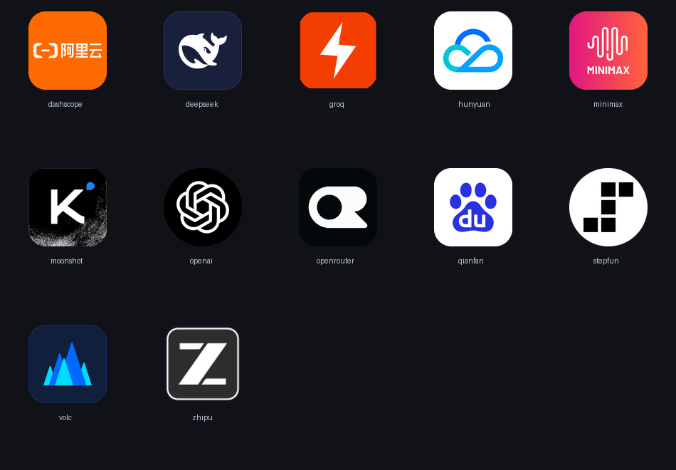

# AI API 中心

> 一个本地优先的 Android 应用：把各家 AI 平台的 API Key、接口地址和账户入口收在一处。

你手上有几个 AI 平台的账号？DeepSeek 的 key 存在哪、Kimi 的余额怎么看、通义千问的 base_url 到底是哪个……
每家一个控制台、一套菜单，平时不用就忘。这个应用把它们收进一个界面，**所有数据只存在你手机里**。

## 它解决什么问题

| 麻烦 | 这个应用怎么做 |
|---|---|
| Key 散落在各处，忘了存哪 | 本地加密密钥本，按平台归组，可存多条、可标注用途、一键复制 |
| 每次看余额都要重新登录、点三四层菜单 | 保存网页登录态，直接落到用量/余额页，不用再找 |
| 记不住某家的接口地址 | 内置 19 家的 OpenAI 兼容 `base_url`，直接复制粘进代码 |
| 想加平台时找不到入口 | 可以自己新建平台，填名字、两个网址、接口地址、图标 |

## 功能

- **19 家平台**，每家预置 4 个深链：API Key 管理页、费用/用量页、控制台首页、接口文档
- **本地密钥本**：AndroidKeyStore 加密（不可导出的 AES-256），支持多条、名字、用途备注、掩码显示、复制、删除
- **余额卡片**：5 家能直接读出金额并缓存，其余一键跳网页
- **网页登录态**：WebView + 持久 Cookie，登录一次之后不用重复登录
- **自定义平台**：自己填名称、简称、品牌色、两个网址、接口地址、图标（可从相册选）
- **多套配色**：主色可切换
- **零第三方依赖**：纯 Java + 系统 View，APK 约 330KB



## 隐私与安全

这一节比功能重要。

- **没有服务器。** 本项目不运营任何后端，应用不会把数据发到作者或第三方。
- **Key 只存在本地。** 用 AndroidKeyStore 生成的不可导出 AES-256 密钥加密后写入应用私有目录。
  应用被卸载时密钥随之销毁，密文无法还原。
- **`allowBackup="false"`。** 密钥不会随系统备份上传到云端。
- **只在两种情况下联网：**
  1. 你点击平台入口，WebView 加载该平台官网；
  2. 你为某个平台存了 Key 并查看余额，请求**该平台官方接口**。

  除此之外没有任何网络行为，没有统计、没有埋点、没有广告 SDK。
- **权限只有两个**：`INTERNET`、`ACCESS_NETWORK_STATE`。

如果这些说法你不放心，代码只有 3400 行且无依赖，全部可以直接读。

## 余额自动读取

不是所有平台都能查余额，这是平台侧的限制，不是实现偷懒。

| 平台 | 状态 | 接口 |
|---|---|---|
| DeepSeek | ✅ 可用 | `GET /user/balance` |
| Kimi 月之暗面 | ✅ 可用 | `GET /v1/users/me/balance` |
| 硅基流动 | ✅ 可用 | `GET /v1/user/info` |
| OpenRouter | ⚠️ 需要 Management Key | `GET /api/v1/credits` |
| 智谱 GLM | ⚠️ 未公开接口，可能失效 | 社区逆向所得，不保证长期可用 |

**其余平台没有做自动读取**，原因分两类：

- 阿里百炼、火山方舟、腾讯混元、百度千帆：余额属于**云平台账户**，不在大模型 API 里。
  要查需要各家的 AK/SK 签名（四套不同算法），而普通用户根本不会去创建 AK/SK。
- MiniMax、阶跃、讯飞、零一、百川、OpenAI、Anthropic、Gemini、xAI、Groq：
  要么没有查询接口，要么要求管理级密钥，要么依赖 OAuth。

这些平台仍然可以一键跳到费用页，网页上有什么就看什么。

## 支持的平台

19 家，国内 13 / 海外 6：

`DeepSeek` `智谱 GLM` `Kimi 月之暗面` `阿里百炼·通义千问` `火山方舟·豆包` `腾讯混元`
`百度千帆·文心` `硅基流动` `MiniMax` `阶跃星辰 StepFun` `科大讯飞·星火` `零一万物 Yi` `百川智能`
`OpenAI` `Anthropic Claude` `Google Gemini` `xAI Grok` `OpenRouter` `Groq`

**海外 6 家在中国大陆网络环境下无法直连**，界面里已标注。应用本身不提供任何网络加速能力。

平台数据也可以单独取用：见 [`docs/providers.json`](docs/providers.json)。

## 构建

需要 JDK 17、Android SDK 34。项目零第三方依赖，不需要下载任何库。

```bash
# Linux / macOS
./gradlew assembleDebug

# Windows
gradlew.bat assembleDebug
```

产物在 `app/build/outputs/apk/debug/app-debug.apk`。

首次构建需在 `local.properties` 里写 `sdk.dir=<你的 Android SDK 路径>`。

最低支持 Android 6.0（API 23），targetSdk 34。

## 已知限制

- **深链会失效。** 各家控制台改版频繁，19×4 个链接需要持续维护。
  发现失效请开 issue，附上「平台 + 哪个页面 + 现在跳到了哪」。
- 部分平台的 logo 拿不到高清源，界面上用品牌色首字母代替。
- 智谱的余额接口是社区逆向结果，随时可能停用。

## 免责声明

本项目为个人工具，**与上述任何公司均无关联，也未获其授权或认可**。
平台名称与图标版权归各自所有者，此处仅用于识别与指示。

API Key 的保管责任在你自己。请勿在不可信设备上录入 Key。

## 许可

[Apache License 2.0](LICENSE)
